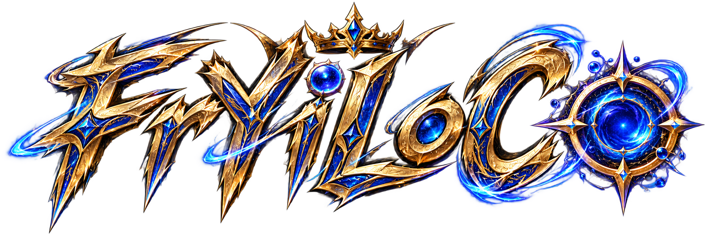

  
  <h1>FrYiLoCo</h1>
  
<strong>Every League of Legends skin, applied automatically. Alone or with your friends.</strong>

  

    <a href="https://github.com/frilo369/FrYiLoCo-Releases/releases/latest/download/FrYiLoCo-Setup.exe"><strong>Download for Windows</strong></a>
    ·
    <a href="https://github.com/frilo369/FrYiLoCo-Releases/releases">All releases</a>
  

FrYiLoCo is a skin catalogue and automatic patcher for League of Legends on Windows. Pick
any skin or chroma for any champion, and FrYiLoCo puts it in your game when champion select
ends. There is nothing to press. Play with friends in Party Mode and everyone sees each
other's skins.

The skins only show on your own computer, and for party members running FrYiLoCo. Other
players see the default skin.

## Contents

- [Install](#install)
- [Your first game](#your-first-game)
- [The skin catalogue](#the-skin-catalogue)
- [Automatic patching](#automatic-patching)
- [Party Mode](#party-mode)
- [The skin database](#the-skin-database)
- [Custom skins](#custom-skins)
- [Custom mods (beta)](#custom-mods-beta)
- [Themes](#themes)
- [MetaSRC builds](#metasrc-builds)
- [Settings](#settings)
- [Updates](#updates)
- [Privacy](#privacy)
- [Good to know](#good-to-know)

## Install

1. Download **[FrYiLoCo-Setup.exe](https://github.com/frilo369/FrYiLoCo-Releases/releases/latest/download/FrYiLoCo-Setup.exe)**.
2. Run it. Windows may warn that the publisher is unknown, because FrYiLoCo is not
   code-signed. Choose **More info → Run anyway**.
3. Setup installs everything FrYiLoCo needs, including the League Toolkit patcher. It
   downloads the patcher from League Toolkit's official releases and verifies it before
   installing, so you need an internet connection.

FrYiLoCo runs on Windows 10 and 11 (64-bit). It starts with Windows and waits in the system
tray, so it is ready before your first champion select.

## Your first game

1. Open FrYiLoCo. On its first start it downloads the skin database and the shared custom
   skins by itself; the catalogue fills in when that finishes.
2. Queue up in League as usual.
3. When you pick your champion, its skins open in a panel docked over champion select.
   Double-click one.
4. That's it. As champion select ends, FrYiLoCo prepares your skin while League starts, and
   your skin is there when the game loads.

When the match ends, your skins are switched off, so every game starts from a clean
selection.

## The skin catalogue

- **Every champion, every skin.** Browse champions in a grid, search by name, filter by role
  (Top, Jungle, Mid, Bottom, Support), and sort A–Z, Z–A, most skins or fewest skins.
- **Chromas.** Chromas sit under their base skin. Open the skin to pick a colour.
- **Forms and editions.** Skins with forms or tiers carry their own art and a **FORM**,
  **TIER** or **EDITION** badge: Elementalist Lux, Gun Goddess Miss Fortune, Arcane
  Fractured Jinx, DJ Sona's genres, Revenant Reign Viego's swords, the Hall of Legends
  editions and more.
- **Skins.** Every Riot skin from every champion in one gallery.
- **Custom Skins.** Your custom skins as a gallery of artwork, each with its champion's
  portrait.
- **Your picked champion, bottom left.** The button in the bottom-left corner shows the
  champion you picked for the current match. Click it to open that champion's skins.
- **It remembers where you were.** Search, selection and scroll position are kept while the
  app is open.

In champion select, the **docked catalogue** sits over the lower middle of the League client
as soon as you choose a champion. It has Skins and Custom tabs, and folds into a small tab
with a click outside it. If you turn it off in Settings, the app's own catalogue opens instead
when you lock in.

## Automatic patching

You never have to press anything to apply your skins.

- As champion select ends, FrYiLoCo briefly holds League's game launch while it builds your
  skins, then lets it go. You can still change skins until about three seconds after the game
  has started, and your latest choice is used. The hold never lasts longer than 50 seconds.
- It works in Summoner's Rift, ARAM, ARAM: Mayhem and Arena.
- **Force Patch.** If your game closes while the match is still running, because of a crash
  or because you quit to change a skin, the status bar turns into **Force Patch**. Press it
  and your skins are prepared before you reconnect.
- When the match ends, the patcher stops and your skins are turned off for the next game.

## Party Mode

Play with friends and see each other's skins.

1. Press **Party** in the left rail.
2. One person presses **Create Party** and gets a four-character code, like `K7QX`.
3. Everyone else enters that code and presses **Join Party**. A party holds up to 8 players.

Once you're in a party:

- Everyone's skin picks are synchronized, so you see your friends' skins in game and they
  see yours.
- Pick your own name and party icon.
- Nobody has to press Ready. Everyone is readied automatically near the end of champion
  select, and the whole party prepares together. A friend whose PC fails or goes silent does
  not stop the others: after a short wait your own skins go ahead.
- **Same version.** Everyone in a party must run the same FrYiLoCo version. If the party is on
  a newer one, FrYiLoCo says so and offers the update. After an update, rejoin the party; once
  everyone has updated, the party carries on with the new version.
- **Same database.** If your skin database is older than someone else's, you get a warning
  with one button that updates it. Everyone needs the same database to see the same skins.

Party Mode only sends small skin identifiers through the FrYiLoCo relay, never the skin files
themselves.

## The skin database

The Riot skins come from the
[FrYiLoCo Skins Database](https://github.com/frilo369/FrYiLoCo_Skins_Database) and are kept
in `%LOCALAPPDATA%\FrYiLoCo`:

- **Riot Skins** holds the official skins. Each new database release replaces it whole.
- **Custom Skins** is yours, with a folder for every champion.
- **Custom Mods** holds minion, map and other cosmetic mods.

FrYiLoCo checks for a newer database when it starts and updates it by itself between
matches. If anything goes wrong, your previous database is put back. **Settings > Library**
shows when it was last updated and can check again. The database can't change during a match.

## Custom skins

`%LOCALAPPDATA%\FrYiLoCo\Custom Skins` has a folder for every champion, named like the
champion (`Ahri`, `Kai'Sa`, `Nunu & Willump`…). Put a `.fantome` skin in its champion's
folder, then open **Custom Skins** in the left rail. Custom skins are turned on and patched
just like official ones.

FrYiLoCo also downloads the skins of its shared custom skin collection that you don't have
yet, when it starts and from **Update Custom Skins** in **Settings > Library**. It only ever
adds: a skin you already have, under any name, isn't downloaded again, and nothing of yours
is replaced. The one exception is a skin the collection withdrew as broken: an exact copy of
it moves to the Recycle Bin.

## Custom mods (beta)

**Custom Mods** in the left rail imports `.fantome` and `.modpkg` packages for minions, maps
and other cosmetics. Enable a mod before a match and it patches alongside your skins; mods
are switched off after each match. In a party, a mod syncs to every member who has the same
package in their Custom Mods folder.

## Themes

Open **Themes** in the left rail to change the look of the whole app. Each theme has its own
artwork and a colour palette that matches it:

Event Horizon (the default), Spirit Blossom, Unlimited Void, Gold Filament, Astral Peaks,
Blue Dream, Crimson Cyberpunk, Cyan Cosmos, Itachi Amaterasu, Howling Abyss ARAM, Midnight
Downpour, Minecraft Gold & Diamond, Crimson Horizon, Magenta Hush, Eclipse Drift, Crimson
Violet, Celestial Cat, Starlit Reverie, Lakeside Seven, Glitch Eye and Chromatic Flow.

Themes work offline. An enabled skin is always green, whatever the theme.

## MetaSRC builds

During loading or a game, press **F1** to open the MetaSRC build page for your champion in
its own window, with the ads hidden. You can choose another key in **Settings > Behaviour**.
MetaSRC never opens by itself, and it closes when the game ends.

## Settings

Open Settings with the gear on the top bar.

| Setting                   | What it does                                                                |
| ------------------------- | --------------------------------------------------------------------------- |
| **Library**               | Shows and opens your Riot Skins, Custom Skins and Custom Mods folders.      |
| **Skin support**          | Downloads and verifies the files LTK needs to check skins again.            |
| **League of Legends**     | The game folder your skins are patched into.                                |
| **Start with Windows**    | Starts FrYiLoCo in the system tray when Windows starts. On by default.      |
| **Live status**           | Shows the live session panel at the top right.                              |
| **Theme updates**         | Keeps your own theme when an update changes the default one.                |
| **MetaSRC keybind**       | The key that opens MetaSRC in game. F1 by default.                          |
| **Docked catalogue**      | Shows your skins in a panel docked over champion select.                    |
| **Champion select**       | Opens your champion's skins in the app when you lock in (docked panel off). |
| **Patch sounds**          | Plays the game launch and dodge sounds.                                     |
| **Champion select focus** | Brings FrYiLoCo in front of League when you lock in.                        |
| **Logs**                  | Opens the log folder, for a bug report.                                     |
| **Updates**               | Shows your version and checks for a new one.                                |

## Updates

FrYiLoCo checks for an update when it starts and installs it by itself, between matches, then
restarts on the new version. Every update is signed, so FrYiLoCo only installs updates that
really come from FrYiLoCo.

The download link at the top of this page always gives you the newest version.

## Privacy

- No telemetry is sent unless you turn it on.
- Log files leave out your Windows user name: the path to your profile is written as
  `%USERPROFILE%`, so a log can be shared.
- Party Mode sends your party name, a random member ID, your app and database versions and
  your skin identifiers, nothing else.
- Setup and database updates download from GitHub. Skin artwork may load from Riot's own
  image servers, with bundled champion icons as a fallback when you're offline.

## Good to know

- **Keep FrYiLoCo running before champion select.** It watches the League client to know when
  to patch, so it has to be open before champion select ends. Starting with Windows takes
  care of this.
- **League patches.** A League or Vanguard update can occasionally stop skins from working
  until FrYiLoCo or League Toolkit is updated.
- **Party members need the same version and database.** A skin missing from your database
  can't be shown to you. Update when the party warns you.
- **Chroma colours** are worked out from their names, so a few may not match Riot's exact
  colour.

## License

FrYiLoCo is built on [League Toolkit](https://github.com/LeagueToolkit)'s
[LTK Manager](https://github.com/LeagueToolkit/ltk-manager) and is licensed under the
[GNU General Public License v3.0 or later](LICENSE). The patcher components are covered by
the [LTK Patcher License](LTK-PATCHER-LICENSE.md).

FrYiLoCo is not an official League Toolkit or Riot Games product, and is not endorsed by
Riot Games.
